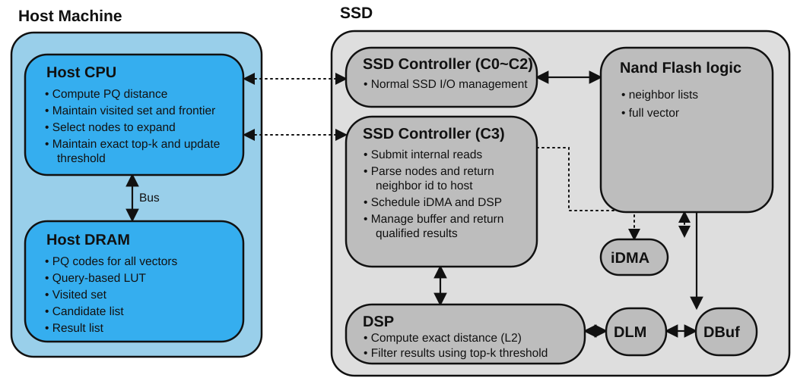

# Host–SSD Codesign: VUC and Simulator Plan

## Research question

At a fixed search quality (recall), does offloading batched node expansion and
candidate distance filtering from the Host to SSD controller C3/DSP improve
query latency or throughput? Which resource (NAND, C3, iDMA, DSP, or DBuf) limits
the gain?

The VUC is the mechanism used to submit work to C3. The outcome of interest is
end-to-end search performance, not command latency by itself.

## Target architecture

The dotted Host links show the two logical request paths: ordinary NVMe I/O is
handled by C0-C2, while batched search work is routed to C3. The drawing is a logical
architecture view; it does not by itself specify the physical NVMe function,
queue mapping, or DMA command format.

## Host-visible device and command routing

The Host sees one NVMe controller/namespace. Ordinary READ/WRITE commands and
VUC transport commands enter through that controller's NVMe
submission/completion queue interface over the emulated PCIe device. NVMeVirt
dispatches ordinary I/O to its existing storage path and routes the reserved
staging WRITE and C0 result fetch to an internal C3 work
queue. C3 is an SSD-internal resource, not another Host-visible `/dev/nvme*`
device. Internal NBR/vector reads are submitted to MQSim and contend for the
same modeled NAND resources as ordinary I/O.

The measurement path submits the VUC through Linux NVMe passthrough and
completes through NVMeVirt's CQ. Because VUC input is Host-to-Controller and its
result is Controller-to-Host, the realistic v1 interface uses an
`EXPAND_AND_FILTER_BATCH` input command followed by a `FETCH_BATCH_RESULT`
output command, correlated by query/batch ID. This remains one expansion per
batch, rather than one command per node.

Report two time domains separately:

- Host wall time from command submission through CQ completion, including the
  Linux driver and NVMeVirt emulator software overhead.
- MQSim modeled device time for NAND and configured C3/DMA/DBuf/DSP stages.

NVMeVirt is a software PCIe device emulator, so Host wall time is a real
measurement through the Linux storage stack and emulator, not physical PCIe
hardware latency. Also record daemon/kernel simulation overhead; otherwise
slow simulation execution can be mistaken for modeled SSD service time.

## V1 workload and comparison boundary

V1 runs a C++17 Host graph-search implementation over SIFT1M in the independent
`../vucann` project (`build/vucann_search`). Its CMake build includes a local
snapshot of `nvmevirt/vuc_protocol.h`; protocol changes must update both copies. Host keeps PQ
codes, PQ pivots, frontier, visited IDs, and exact top-k threshold in DRAM. It
sends one expansion request per frontier batch, then fetches that batch's result.
C3 parses the requested
nodes' neighbor lists, returns all unique discovered neighbor IDs for Host PQ
updates, reads full vectors for the expanded nodes and discovered neighbors,
computes exact L2, applies the current threshold, and returns the sorted
per-batch top-k candidates.

Neighbor lists and full vectors use distinct page-aligned files in the
NVMeVirt memory-backed namespace. For SIFT1M with 64-neighbor records, NBR
records are 260 bytes, 15 per 4 KiB page; 128-D FP32 vectors are 512 bytes, 8
per page. `node_id -> NBR slot` and per-file page-to-LBA maps are explicit.
The latter come from filesystem extents and allow fragmented files while
preserving 4 KiB alignment.

Ordinary block I/O and VUC now use the same Host-visible NVMeVirt namespace.
The Host sends C1 input as a standard NVMe WRITE to a reserved out-of-range
staging SLBA. This is deliberate: Linux's generic passthrough path infers DMA
direction from the command opcode, so a vendor opcode would not safely map an
H2C payload. NVMeVirt recognizes this reserved WRITE, copies its PRP payload
into a bounded shared-memory IPC slot, and dispatches it to C3. The paired C0
vendor command fetches the cached result back through C2H PRPs. The Host client uses this paired NVMe passthrough path.

The C1 staging WRITE uses the reserved SLBA `0xfffffffffffffff0`. Its CDW12
contains the zero-based LBA count and CDW13 carries the actual C1 payload byte
count; the transfer is padded to the namespace logical block size. The request
still identifies the semantic operation as `EXPAND_AND_FILTER_BATCH` with
opcode `0xC1` inside the payload. C0 CDW10–13 carry the 64-bit query and batch
IDs, and CDW14 carries the result capacity. Transfers are limited to the IPC's
64 KiB payload slot. The daemon stores a successful result by query/batch until
C0 fetches it.

The Host client issues `NVME_IOCTL_IO_CMD` on the NVMe namespace device (for
example `/dev/nvme0n1`) and supplies the namespace ID. Its paired wait time is
the sum of the staging WRITE and C0 ioctl wall times. Overall Host query time
also includes PQ/frontier work and software-emulator overhead. This measures
the Linux NVMe path through a software PCIe device, not physical PCIe hardware.

Initial workload: 1,000 SIFT1M queries, `L=20,60,120`, `W=16`, `K=10`. Report
recall@10, Host wall time, and the per-batch C3 queue, NBR/vector NAND, DMA,
parse, and DSP stages. Unmeasured Phison compute and transfer costs remain
explicit sensitivity inputs; the zero-cost values are controls, not hardware
measurements. In this simultaneous-search-and-exact-scoring version, returned
exact scores update Host's result list and threshold before the next batch.

## First model boundary

Use one VUC per batch of nodes selected by the Host. The Host continues to own
the priority queue/frontier, visited set, and exact top-k threshold. C3 reads
the requested nodes' adjacency lists and vectors, performs the modeled neighbor
parsing and distance/filter work, and returns qualified candidates. This keeps
the initial comparison focused on placement of work; C3 does not choose the
next frontier in this version.

Keep ordinary NVMe reads/writes on the current C0–C2 path. NVMeVirt recognizes
the two VUC opcodes separately, moves their PRP payloads through bounded IPC
slots, and tracks their MQSim completions independently of READ/WRITE metadata.

## VUC v1 semantic contract

One expansion command represents one query batch: `EXPAND_AND_FILTER_BATCH`.
Host sends the node IDs selected from its frontier; C3 does not select the next
expansion nodes. For the PCIe path, Host-to-Controller input and
Controller-to-Host output use separate `EXPAND_AND_FILTER_BATCH` and
`FETCH_BATCH_RESULT` commands. `nvmevirt/vuc_protocol.h` defines the service
request and serialized result layouts; the Host client maps these onto command
dwords and PRP payloads.

Input fields:

`query_id`, `batch_id`, simulator-domain `submit_time_ns`, `node_count`,
`node_list_ref`, `node_list_bytes`,
`query_ref`, `query_bytes`, `top_k`, FP32 `threshold`,
`threshold_format`, `neighbor_ids_ref` / capacity, and
`candidates_ref` / capacity. Query vector and node list are input DMA buffers;
the two output arrays use separate buffers.

### Result semantics required by graph search

There are two outputs, because the Host needs every discovered neighbor ID to
compute PQ distance and update its frontier, even if that neighbor's exact
distance is above the current result threshold:

- `discovered_neighbor_ids`: unique IDs discovered by parsing the requested
  adjacency lists. Host filters these through its visited set and computes
  their PQ distances.
- `candidates`: unique `(node_id, source_node_id, exact_distance)` records
  that pass the FP32 threshold. C3 sorts ascending and returns at most `top_k`.

The candidate list is not a substitute for the discovered-neighbor list. A
single output list filtered by exact threshold could make Host skip nodes whose
PQ rank would otherwise put them on the frontier, changing search behavior.

If either output capacity is too small, C3 reports the number actually
written, sets `RESULT_OVERFLOW`, and sets `result_valid=1` only when both arrays
contain a complete result. Host must not treat a truncated neighbor list as a
complete expansion; it may retry with larger buffers. Other failures return
zero counts and `result_valid=0`, except where the completion explicitly says
the partial output is valid.

Completion echoes `query_id` and `batch_id`, status, valid counts, byte counts,
and per-stage timing. `SUCCESS` means NBR/vector reads and C3 parsing/DSP work
are done and output buffers are visible to Host.

The current timing model follows the [hardware constraint audit and explicit
assumptions](vuc_timing_model.md). Default DBUF and DLM are 128 KiB each. Internal
reads are capped at 16 until DBUF-ready, including an explicitly assumed ECC
tail. NBR parsing reads DBUF directly. Vector pages traverse DBUF -> DLM -> DSP
-> DBUF -> controller candidate update. Both DMA directions share ONE lane;
DMA setup and 4 KiB transfer time are charged separately. The shared query is
loaded into DLM once per batch through that same lane. DBUF slots are reserved
before reads and held until parse or candidate update; DLM reservations include
a shared query page and bounded vector/result working pages.

Nonzero DMA, parser, DSP, ECC and update defaults are sensitivity assumptions,
not hardware measurements. The detailed document gives derivations, ranges,
CLI names, trace interpretation, and remaining limitations. `--vuc-trace` emits
per-page stage boundaries. The static page-dependency lookahead remains untimed;
full graph traversal is still on Host. The paired Linux WRITE/FETCH transport
still incurs two Host commands per batch, not the hardware's single SQ/CQ pair.

At most one batch per query is outstanding in v1; different queries may be
outstanding concurrently. The C3 queue and DSP/read resources are separate
simulated resources. Ordinary block I/O stays on the existing NVMeVirt to
MQSim path. The simulator-side VUC entry is distinct from READ/WRITE; this ABI
does not claim that the current kernel driver already accepts a vendor NVMe
command.

## Relationship to standard NVMe commands

“Using the NVMe command format” and “being compatible with standard NVMe
semantics” are different. A VUC can use the existing 64-byte submission queue
entry and repurpose fields or a vendor-specific opcode, while requiring custom
SSD firmware and a custom host interface. A standard driver/device will not
know what the search fields mean. Do not silently overload ordinary READ or
WRITE semantics.

InstANNS is a relevant precedent: its IPQF is described as a custom NVMe
command, and it repurposes the DSM command format and its fields for query-aware
PQ filtering. The paper says existing hardware and storage drivers do not
support IPQF; the authors implemented it using NVMeVirt and SPDK. It also
explains that input transfer and result retrieval need separate write/read
operations under NVMe command semantics, and addresses their ordering as a
paired operation. This supports reusing the NVMe transport/command envelope,
not claiming stock-driver compatibility. The paper's operation is specifically
PQ filtering; its exact command layout should not be copied for our graph-node
expansion unless the payload and completion behavior match.

For our first simulator implementation, keep SEARCH as a distinct IPC/model
request type. Later choose one concrete NVMe interface: (A) one vendor command
with host-provided input/output DMA buffers and a single completion, or (B) a
paired input command and result-read command linked by query/batch ID. Option A
fits a direct C3 request/response abstraction; option B is closer to a design
where the SSD accepts a write-like input and exposes output for a subsequent
read. Whichever is selected, model data movement and ordering explicitly.

## Simulator changes, in implementation order

1. **Request ABI and dispatch**: add a versioned SEARCH/VUC request type to the
   shared IPC protocol, carrying the semantic fields above. Preserve READ and
   WRITE behavior. Have NVMeVirt recognize only the chosen vendor opcode and
   submit it asynchronously through the same request-ID/pending completion
   machinery. Define a valid command data-buffer format and failure status.
2. **C3 work queue**: add a separate C3 queue and configurable command service
   slots/service cost. Queue wait and service time are separate statistics.
3. **NAND reads**: map requested node IDs to configured logical addresses and
   inject internal reads through MQSim's existing FTL/TSU/PHY path. These reads
   must contend with ordinary C0–C2 traffic for NAND channels/chips/dies.
4. **iDMA and DBuf**: model bytes and transfer bandwidth for adjacency/vector
   movement. Give DBuf finite capacity and hold/release buffer slots at defined
   producer/consumer points so full-buffer backpressure can delay future reads.
5. **DSP**: schedule exact-distance work with configurable parallel units and
   service cost derived from vector dimension and candidates processed. Record
   DSP queue wait separately. Return qualified candidates and completion status.
6. **Host search loop**: initially model Host-side PQ/visited/frontier work as
   configurable service and memory traffic. Later, replace the synthetic loop
   with the actual search implementation if recall-quality experiments require
   it.

Make service capacities, latencies, vector dimension, adjacency bytes, and
DBuf capacity explicit parameters. Do not bury all of these in one fixed DSP
delay: that would not reveal which resource causes a bottleneck.

## Comparison and outputs

Compare Host-only and C3/DSP-offload with identical graph, query set, initial
frontier, batch policy, and recall target. Sweep query concurrency and batch
size; then sweep DSP units/speed, iDMA bandwidth, and DBuf capacity.

Primary metrics:

- query latency: mean, P95, and P99;
- QPS at the same recall target;
- stage latency: Host, command transport, C3 queue/service, NAND, iDMA,
  DSP queue/service, and result return.

Diagnostic metrics:

- NAND read count and channel/die queue wait;
- C3 and DSP queue depth/wait and busy time;
- iDMA bytes and transfer wait;
- DBuf occupancy, full cycles, and backpressure time;
- candidates returned, filtered, and buffer-overflow count.

Every timestamp should use the simulator's event-time domain. Report warmup and
preconditioning state because cold mapping reads and steady-state SSD behavior
can produce materially different results.

## Hardware feedback and modeling assumptions

The current hardware feedback gives these constraints for the first model:

- A batch of 32 × 4 KiB or 128 × 4 KiB is submitted with one SQ/CQ pair. Model
  command/queue overhead once per batch, and model the payload/data work by its
  byte count. Do not charge one host SQ/CQ round trip per 4 KiB unit.
- Internal NAND reads are asynchronous, with a maximum outstanding depth of
  16. Model an internal read queue with configurable depth and use 16 as the
  hardware-reported limit. Larger batches may require multiple waves of reads.
- DBuf's allocation/transfer unit is 4 KiB. The current measurements do not
  establish throughput below 4 KiB, so do not extrapolate a sub-4-KiB rate.
- Data entering DBuf and data moving from DBuf to DLM use the same hardware
  channel and cannot overlap. Model these transfers as mutually exclusive
  stages on one serialized resource. Although data movement and update may
  overlap in the experimental workflow, their throughputs were measured
  separately; do not infer a combined simultaneous throughput from those
  numbers.
- PQ ADC kernel cost and full-vector distance cost are not currently known.
  Keep them as explicit configurable parameters, label any assumed values, and
  sweep them in sensitivity analysis. Do not present a point estimate based on
  invented compute latency as a measured result.

These constraints refine, but do not alter, the VUC contract: one command still
describes one node batch. In the timing model, separate host SQ/CQ overhead,
internal async NAND reads, serialized DBuf-channel transfers, DSP/PQ work, and
completion. Record the time each stage waits for its resource so that the
16-read limit and shared-channel serialization are visible in results.

Suggested first batch sweep: 32 × 4 KiB and 128 × 4 KiB, with internal read
depth 1, 4, 8, and 16. Keep DBuf transfers in 4 KiB quanta. For the unknown
compute stages, report curves over a range (including zero-cost and
compute-dominated cases) until hardware measurements are available.

## What the first implementation should claim

The first end-to-end prototype should claim only that it models the defined
Host-selected batch path and its resource contention. It should not claim
ANN-level speedup or fixed-recall improvement until the same graph/query search
semantics and recall are actually evaluated. Validate the model in layers:
zero-cost C3/DSP controls, isolated resource sweeps, then mixed ordinary I/O and
search traffic.
