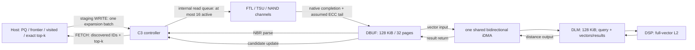

# VUC timing model: hardware constraints and assumed baseline

This describes the implementation after the 2026-10-20 timing correction.
Hardware feedback is a constraint, not a latency measurement. No numerical DSP,
DMA, ECC, or firmware latency was supplied. Values below are explicit research
assumptions, not calibrated Phison performance. NAND parameters remain those of
`mqsim/ssdconfig.xml`; they are not established vendor device specifications.

## Constraint audit

| Hardware feedback / requested experiment | Implementation / boundary |
|---|---|
| Async internal reads: maximum 16 | Enforced 1..16, counted until DBUF-ready (including assumed ECC tail). 32/64/128 requests can queue, but cannot be 32/64/128 active hardware reads. |
| DBUF 128 KiB, 4 KiB allocation | Default 32 pages; allow smaller capacities for sensitivity, reject >32. Reserve before submission; NBR releases after parse, vector releases after return and controller update. |
| DLM 128 KiB | One 4 KiB query reservation plus up to 31 4 KiB vector/result reservations. A vector page is logically overwritten by scores after DSP. Reservation begins before its read; this is conservative versus just-in-time allocation. |
| Data-to-DLM and data-to-DBUF cannot overlap | Both directions use one shared iDMA lane; reject `--vuc-idma-units` other than 1. DSP may overlap another page's DMA. |
| No measured sub-4-KiB throughput | Charge a whole 4 KiB transaction even for a page's small score output; no sub-4K bandwidth claim. |
| One SQ/CQ for a 32/128-page internal batch | Internal page reads do not create Host commands. Current Linux transport still requires two Host commands per expansion: staging WRITE and FETCH. This is NOT physically one SQ/CQ pair. |
| PQ ADC: 32-byte codes, 32 KiB LUT | Not implemented in C3. Existing Host search uses 128-byte PQ codes; C3 exact-scores 128-D vectors. Do not describe L2 results as PQ ADC results. |
| Internal read sequential/random and balanced placement | Current VUC reads follow the graph and supplied page-to-LBA maps, not a controlled sequential/random microbenchmark. Inspect native per-channel/LUN counters; logical randomness does not guarantee physical balance. |

The supplied figure's “Data to DBUF” is interpreted as **DSP/DLM result return**,
paired with “Data to DLM”. NAND-to-controller data transfer is already in MQSim's
NAND channel model and is not added a second time as iDMA. If the vendor also
means NAND ingress shares this exact DBUF/DLM engine, a common reservation must
be integrated into MQSim PHY; this implementation does not assert that stronger
hardware constraint. This distinction requires confirmation from the vendor.

## Architecture and lifetime



Draw the data paths, directions, shared DMA resource, queue depth and capacities.
Do not draw every electrical connection. Node parse and candidate update share
controller parser lanes. NAND can run during DSP; the two iDMA directions cannot
run together. Graph traversal remains on Host, so the SSD DRAM frontier/visited
budget in the proposed future architecture is not implemented here.

A billion-node visited bitmap takes 125 MB decimal (~119.2 MiB); for SIFT1M it
is 125 KB decimal. The current Host implementation uses a hash set, not that
1-bit bitmap. DRAM capacity cannot be inferred from “NAND capacity / 1000” without
an explicit device capacity and allocation policy.

## Explicit default assumptions and sensitivities

| Parameter / CLI suffix (all have `--vuc-`) | Default | Rationale and suggested sweep |
|---|---:|---|
| `max-async-reads` | 16 | Hardware limit; sweep 1,4,8,16. Larger batches queue. |
| `dbuf-capacity-pages` | 32 | Hardware 128 KiB; sensitivity 1,4,16,32. |
| `dlm-capacity-pages` | 32 | Hardware 128 KiB; sensitivity 2,8,16,32. |
| `idma-units` | 1 | Hardware shared bidirectional lane. |
| `idma-setup-ns` | 200 | Assumed descriptor/setup cost; sweep 50,200,1000 ns. |
| `idma-ns-per-4k` | 2048 | Assumed sustained 2 GB/s (decimal), e.g. effective 4 B/cycle at 500 MHz; sweep 1024,2048,8192 ns. |
| `input-dma-ns-per-4k`, `output-dma-ns-per-4k` | 1024 each | Assumed 4 GB/s Host link payload; sweep 1024,2048,4096 ns. Separate from internal DMA. Controller frontend/completion setup already charged in NVMeVirt. |
| `parse-ns-per-id` | 10 | 5 controller cycles per neighbor at assumed 500 MHz, covering bounds/load bookkeeping; sweep 5,10,40 ns. |
| `candidate-update-ns-per-node` | 20 | 10 cycles per scored node, amortized small-top-k controller work; sweep 10,20,100 ns. Not a general large-K sorting model. |
| `dsp-ns-per-component` | 2 | 128 cycles per 128-D L2 at assumed 500 MHz; derivation below; sweep 1,2,8 ns. |
| `dsp-setup-ns-per-page` | 64 | 32 cycles per page's DSP invocation at 500 MHz; sweep 0,64,256 ns. |
| `ecc-ns-per-4k` | 1000 | Assumed fixed clean-read ECC tail after MQSim completion; sweep 0,1000,5000 ns. No ECC engine contention, correction severity or read-retry distribution is modeled. |
| `parser-units`, `dsp-units` | 1 each | Assumed one controller execution lane and one DSP. More lanes are hypothetical sensitivity, not confirmed hardware. |

The startup log prints the effective costs; overrides can intentionally select
zero-cost controls. No nonzero point estimate should be reported without a sweep.
Existing NVMeVirt controller defaults remain 10 us frontend and 8 us completion,
3 lanes each; these are legacy sensitivity inputs, NOT vendor measurements.
There is no separate unknown “firmware latency” silently set to a measured zero:
parse/update/command setup are explicit, while interrupts, dispatch variance,
FTL CPU work beyond MQSim's abstraction, and lookahead/sort costs remain limitations.

### L2 cycle derivation

Assume 500 MHz and a conservative 4-FP32-wide execution group:
per group of four dimensions budget four cycles total for candidate/query loads,
subtraction, multiply/accumulation and amortized reduction/control. This is an
**effective throughput assumption**, not an ISA instruction schedule:

`C_L2(N) = 32 + 128*N`, `t_ns = C * 2`, `candidates/s = N*500e6/C`.

The 32-cycle setup includes query reuse/setup within one invocation; per-candidate
cost includes DLM reads and reduction. DBUF/DLM DMA and NAND are excluded.
The query is common to the batch. The functional reference accumulates distance
in FP64 then stores FP32 scores; timing assumes an FP32 DSP kernel, not an
instruction-accurate or bit-exact DSP emulator. Threshold filtering consumes the
returned FP32 scores after candidate update. Public examples such as
[TI C6655](https://www.ti.com/product/TMS320C6655) advertise multiple FP32 operations
per cycle; this shows why a scalar FLOP count is not a cycle count. It does not
identify our DSP or calibrate its clock, SIMD width or memory bandwidth.

| N, one kernel invocation | L2 cycles | cycles/candidate | candidates/s |
|---:|---:|---:|---:|
| 1 | 160 | 160 | 3,125,000 |
| 16 | 2080 | 130 | 3,846,154 |
| 64 | 8224 | 128.5 | 3,891,051 |
| 128 | 16416 | 128.25 | 3,898,635 |
| 512 | 65568 | 128.0625 | 3,904,344 |

The current pipeline invokes DSP **per vector page**, at most eight scored vectors
per invocation. Its actual cycles are `32*number_of_vector_pages + 128*N`, not
necessarily the one-invocation table. For 512 packed candidates this is 67584
cycles (135168 ns), plus DMA and controller work. 512 FP32 vectors need 256 KiB,
so they must stream through DLM; they cannot all reside in 128 KiB at once.
Sparse pages increase DMA/setup costs per candidate.

For the proposed 32-byte PQ ADC, a provisional analytical assumption is
`C_ADC(N)=32+80*N` at 500 MHz: 32 code-index accesses + 32 dependent LUT accesses
+ 16 amortized accumulation/reduction/control cycles per candidate. This is
**not implemented or charged in C3**, and LUT banking/gather could change it
substantially. Sweep 40/80/320 cycles per candidate; LUT construction is separate.
The resulting single-invocation cycles for N=1/16/64/128/512 are
112/1312/5152/10272/40992. Do not substitute SIMD peak FLOPS for LUT throughput.
32 KiB LUT + 512 codes (16 KiB) + 512 scores (2 KiB) fits the proposed DLM before
other reservations, unlike the full-vector batch.

### DMA derivation

For a contiguous DMA transaction:
`allocated_bytes=ceil(bytes/4096)*4096`,
`setup=200 ns`, `data=allocated_bytes/(2 bytes/ns)`, `total=setup+data`.

| Useful bytes | Charged bytes | Setup ns | Data ns | Total ns | Effective useful GB/s |
|---:|---:|---:|---:|---:|---:|
| 512 | 4096 | 200 | 2048 | 2248 | 0.228 (allocation assumption, not sub-4K measurement) |
| 4096 | 4096 | 200 | 2048 | 2248 | 1.822 |
| 16384 | 16384 | 200 | 8192 | 8392 | 1.952 |
| 65536 | 65536 | 200 | 32768 | 32968 | 1.988 |
| 131072 | 131072 | 200 | 65536 | 65736 | 1.994 |

The actual VUC scheduler issues separate 4 KiB DMA transactions, so it charges
setup for EACH page and EACH direction. A 128 KiB stream therefore costs
32*2248=71936 ns in one direction, before queue waits. The single-descriptor
table is an analytical comparison, not current batching behavior. Output scores
are conservatively charged a whole page per processed vector page.

## Time boundaries and trace

* Internal read: submission into native MQSim to native completion + configured
  ECC tail = DBUF-ready. It excludes DBUF allocation wait before submission.
* Native MQSim includes its mapping, TSU queues, NAND array and channel transfer.
  The XML has 8 channels * 4 chips * 1 die = 32 modeled LUNs; planes are not LUNs.
  NAND page is 8 KiB even though requests/DBUF slots are 4 KiB.
* Online flow uses `Caching_Mode=OFF` for data; CMT mapping cache remains active
  (`Ideal_Mapping_Table=false`). Repeated reads may warm mapping without becoming
  controller data-cache hits. Native init overrides XML caching mechanism to SIMPLE.
* NBR parse reads DBUF directly; no invented NBR DSP copy is charged.
* Shared query: one 4 KiB DMA into DLM per batch on the same lane.
* Vector DBUF-ready -> DMA in -> DSP -> DMA out -> controller update -> slot release.
* Input/output Host DMA use ceil(payload/4K), including protocol headers. The old
  accidental second division by 4096 is fixed.

Enable `--vuc-trace /tmp/vuc-stages.csv`. Rows distinguish `internal_read`, `ecc`,
`parse`, `query_to_dlm`, `dbuf_to_dlm`, `dsp`, `dlm_to_dbuf`, `candidate_update`. `ready/start/finish`
separate waits from service. ECC rows are contained in internal-read latency;
never add both as independent elapsed stages. Tracing adds wall-clock overhead.

```sh
python3 scripts/vuc/summarize_timing_trace.py /tmp/vuc-stages.csv
```

This reports observed read-window throughput/IOPS and mean/P50/P95/P99 per query
batch, using nearest-rank percentiles. Window is first submission to final DBUF
readiness and includes graph dependency gaps. It is NOT saturated internal-read
bandwidth or an independently controlled sequential/random benchmark. A full
pattern/depth benchmark must explicitly fix address range, mapping warmup, seed,
placement and offered queue depth. Depth 32..128 is software backlog, capped at
16 active; record actual channel/LUN counts rather than assuming even balance.

ABI remains v1 to retain Host compatibility. `vector_dma_ns` now aggregates BOTH
directions including setup and the shared query transfer. `neighbor_dma_ns` is zero (parse in DBUF), and
`neighbor_parse_ns` aggregates controller parse + candidate update. Internal NAND
counters include the assumed ECC tail; detailed CSV is the authoritative split.
Old and new experiment results must not be mixed without noting this change.
`command_stage_sum_ns` still is NOT elapsed batch latency; use finish-arrival.

## Verification

```sh
make -C mqsim MQSimIPCDaemon VUCTimingSmoke -j2
python3 scripts/vuc/test_timing_model.py
```

The test executes the native MQSim engine on a tiny image, checks zero/nonzero
cost controls, exact outputs, single-slot DBUF backpressure, DMA serialization,
and dependency ordering through return/update. It is not a hardware calibration
or an NVMe end-to-end performance experiment.
